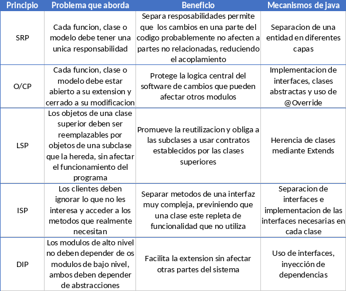

# Taller de principios SOLID

### Integrantes

- Cristian Camilo Ramirez
- Jose Miguel Tapia
- Juan Jose Rodriguez

## Parte A

## Parte B

Este repositorio contiene los ejemplos en codigo Java de cada principio, con su caso correcto e incorrecto, y un **README** con la explicacion de lo que se hizo en cada caso. La carpeta evidencias contiene las capturas de pantalla de la ejecucion de cada proyecto
